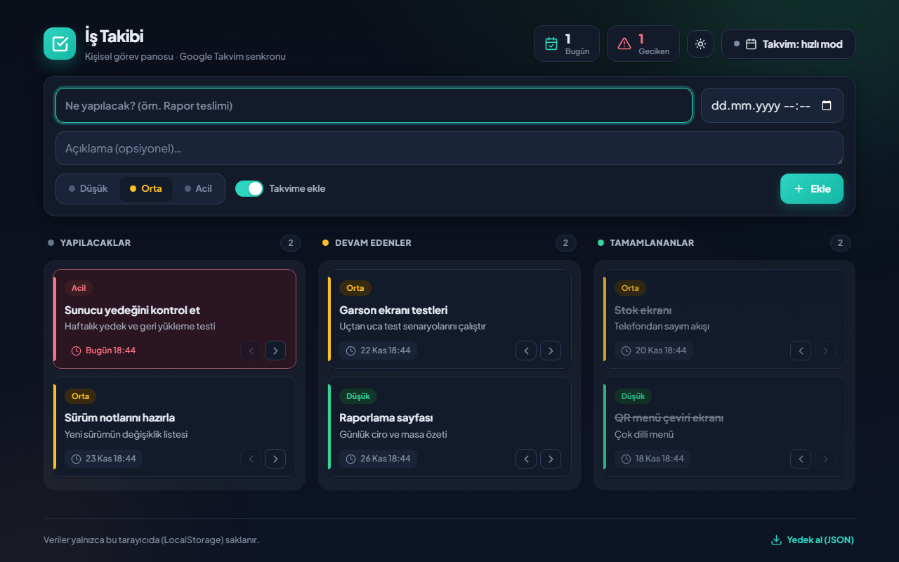

# ✅ İş Takibi — Kişisel Görev Panosu + Google Takvim

**Canlı demo:** https://cpu-mustafa.github.io/is-takip/



Tek kullanıcı için, kayıt/giriş gerektirmeyen, tarayıcıda çalışan bir görev panosu.
Kanban görünümü (Yapılacaklar / Devam Edenler / Tamamlananlar), öncelik, teslim
tarihi ve **Google Takvim senkronu** içerir. Veriler yalnızca senin tarayıcında
(`LocalStorage`) tutulur — hiçbir sunucuya gitmez.

---

## 1) Seçilen teknoloji yığını ve nedeni

| Katman | Seçim | Neden |
|---|---|---|
| Arayüz | **Saf HTML + CSS** (çerçevesiz) | Build/derleme yok, `npm install` yok. Çift tıkla aç, çalışır. |
| Mantık | **Vanilla JavaScript** | React/Next kurulumu bu ölçek için fazladan yük olurdu. |
| Veri | **LocalStorage** | Veritabanı kurulumu yok; tek kullanıcı için ideal, anında. |
| Takvim | **Google Identity Services (OAuth 2.0) + Calendar API** | Olayları otomatik yazar; hatırlatıcılar telefon + bilgisayara düşer. |

**Neden React/Node değil?** İstediğin öncelikler "minimum kurulum, hızlı, yormayan".
Bu yapı build adımı istemez, internetsizken bile görev yönetimi bozulmaz (yalnızca
takvim senkronu internet ister). İleride büyürse React'e taşımak kolay.

## Dosya yapısı

```
İşTakip/
├─ index.html     → arayüz iskeleti (form + kanban)
├─ styles.css     → tasarım (açık/koyu tema otomatik)
├─ app.js         → tüm mantık: görevler, sürükle-bırak, takvim senkronu
├─ config.js      → Google CLIENT_ID ve hatırlatıcı ayarları (SEN doldur)
└─ README.md      → bu dosya
```

---

## 2) Çalıştırma

### Hızlı mod (kurulumsuz)
`config.js` içinde `GOOGLE_CLIENT_ID` boşken uygulama tam çalışır.
"Takvime ekle" (📅) butonu, olayı **önceden doldurulmuş Google Takvim ekranında**
açar; tek tıkla kaydedersin. En hızlı başlangıç budur.

> Not: `index.html`'i çift tıklayarak da açabilirsin. Ancak **otomatik senkron**
> (aşağıdaki OAuth) `file://` üzerinden çalışmaz — yerel sunucu gerekir.

### Otomatik senkron için yerel sunucu
Google OAuth, `http://localhost` gibi bir "yetkili kaynak" ister. Birini seç:

- **VS Code + Live Server eklentisi:** `index.html` → sağ tık → *Open with Live Server*.
- **Python:** klasörde terminal aç:
  ```bash
  python -m http.server 5500
  ```
  Sonra tarayıcıda `http://localhost:5500`
- **Node:**
  ```bash
  npx serve -l 5500
  ```

Hangi portu seçersen, Google Cloud Console'da (Adım 3) **aynı** adresi yetkili
kaynak olarak eklemelisin.

---

## 3) Google Takvim otomatik senkron kurulumu (OAuth 2.0)

Bir defalık ~5 dakikalık kurulum. Ücretsizdir.

1. **Google Cloud Console'a git:** https://console.cloud.google.com/
2. Üstten **yeni proje** oluştur (örn. "IsTakip") ve onu seç.
3. Sol menü → **APIs & Services → Library** → "Google Calendar API" ara → **Enable**.
4. **APIs & Services → OAuth consent screen:**
   - User type: **External** → Create.
   - Uygulama adı, destek e-postası, geliştirici e-postası: kendi e-postan.
   - **Scopes** adımını atlayabilirsin (kodda zaten istiyoruz).
   - **Test users** → **kendi Gmail adresini ekle** (yayınlamana gerek yok;
     test modunda kendi hesabınla çalışır).
5. **APIs & Services → Credentials → Create Credentials → OAuth client ID:**
   - Application type: **Web application**.
   - **Authorized JavaScript origins** → **ADD URI** →
     kullandığın adresi ekle, örn: `http://localhost:5500`
     (birden fazla port kullanıyorsan hepsini ekle).
   - *Authorized redirect URIs boş kalabilir* (token akışında gerekmez).
   - **Create** → çıkan **Client ID**'yi kopyala.
6. `config.js` dosyasını aç, kopyaladığın değeri yapıştır:
   ```js
   GOOGLE_CLIENT_ID: "1234567890-abcdefg.apps.googleusercontent.com",
   ```
7. Sayfayı yerel sunucudan aç → sağ üstteki **"Google Takvim'e bağlan"**.
   Google hesabını seç, izni onayla. Artık tarih/saatli görevler otomatik
   takvime yazılır ve **hatırlatıcı bildirimleri** telefonuna + bilgisayarına düşer.

### Sık karşılaşılan hatalar
- **"redirect_uri_mismatch / origin is not allowed":** Adım 5'teki *JavaScript origins*
  ile tarayıcıdaki adres **birebir** aynı olmalı (`localhost` ≠ `127.0.0.1`, port dahil).
- **"access blocked / app not verified":** OAuth consent screen'de kendini
  **Test user** olarak eklemedin. Ekle, tekrar dene.
- **Bildirim gelmiyor:** Telefonda Google Takvim uygulamasının bildirimleri
  ve ilgili takvimin senkronu açık olmalı. Hatırlatıcı süreleri `config.js` →
  `DEFAULT_REMINDERS` ile ayarlanır.

---

## 4) Kullanım ipuçları

- **Görev ekle:** Üstteki formdan ad + öncelik + (opsiyonel) tarih/saat.
  "Takvime ekle" işaretliyse tarih verilen görev otomatik senkronlanır.
- **Durum değiştir:** Kartı sürükle-bırak **veya** ◀ ▶ oklarıyla ilerlet.
- **Geciken işler** kırmızı çerçeveyle, **bugünküler** vurgulu görünür;
  sağ üstteki sayaçlar özet verir.
- **Düzenle / Sil:** Kart üstüne gelince çıkan ✏️ / 🗑️.
- **Yedek:** Alttaki "Yedek al (JSON)" ile görevlerini dışa aktar.

> Görevler tek tarayıcıya bağlıdır. Başka cihaza taşımak için JSON yedeğini kullan;
> gerçek cihazlar-arası senkron gerekirse yığını küçük bir backend'e (ör. Node +
> SQLite) taşıyabiliriz — mimari buna hazır.
